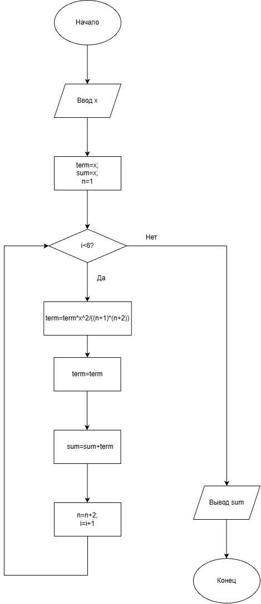

# Домашнее задание к работе 8

## Условие задачи

Задано значение x. Вычислить:
x - (x^3 / 3!) + (x^5 / 5!) - (x^7 / 7!) + (x^9 / 9!) - (x^11 / 11!) + (x^13 / 13!).

## 1. Алгоритм
### Алгоритм
```
1. Начало.
2. Ввести значение x.
3. Задать начальные значения: сумма sum = x, текущий член ряда term = x, степень n = 1.
4. Запустить цикл i от 0 до 5 (всего 6 повторений):
5. Вывести на экран значение sum.
6. Конец.
```
### Блок-схема


## 2. Реализация программы
```
#define _CRT_SECURE_NO_WARNINGS
#include <stdio.h>
#include <locale.h>

int main()
{
    setlocale(LC_ALL, "RUS");
    double x;
    printf("Введите значение x: ");
    scanf("%lf", &x);
    double term = x;
    double sum = x;
    int sign = -1; 
    int n = 1;     
    for (int i = 0; i < 6; i++)
    {
        term = term * (x * x) / ((n + 1) * (n + 2));
        term = -term;
        sum += term;
        n += 2; 
    }
    printf("Значение выражения: %lf\n", sum);
}
```
### 3. Результаты работы программы
```
Ввод: x = 1
Вывод: 0.841471

Ввод: x = 2
Вывод: 0.909296

Ввод: x = 0
Вывод: 0.000000
```
### 4. Информация о разработчике

Дегтярева Полина, бИЦТ-262
